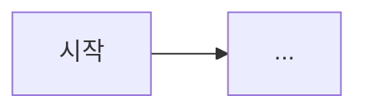

# 01. 사용자 흐름 (서비스 시나리오)

> 사용자가 서비스를 **어떻게 쓰는지**(가입 → 이용 → 오류 상황)를 적는다.
> 게임 스토리·진행 시나리오는 이 문서가 아니라 [../game/](../game/) 에 둔다.

## 1. 문제 정의
<!-- 00-idea 의 문제를 구체적으로. 지금 어떻게 하고 있고 무엇이 불편한가 -->

## 2. 타겟 사용자 (페르소나)

| 사용자 | 특징 | 원하는 것 |
|--------|------|-----------|
| | | |

## 3. 핵심 시나리오
<!-- 정상 흐름뿐 아니라 실패·예외 흐름도 시나리오로 쓴다 (입력 오류, 외부 서비스 장애, 권한 없음 등) -->

### S1. <!-- 예: 신규 사용자 첫 사용 -->
1. 
2. 

### S2. <!-- 예: 오류 상황 -->

## 4. 유저 플로우
<!-- 화면·상태 이동을 다이어그램(mermaid 등)으로 -->

## 5. 시연 순서
<!-- 발표·평가·데모가 있다면 보여 줄 순서 -->
