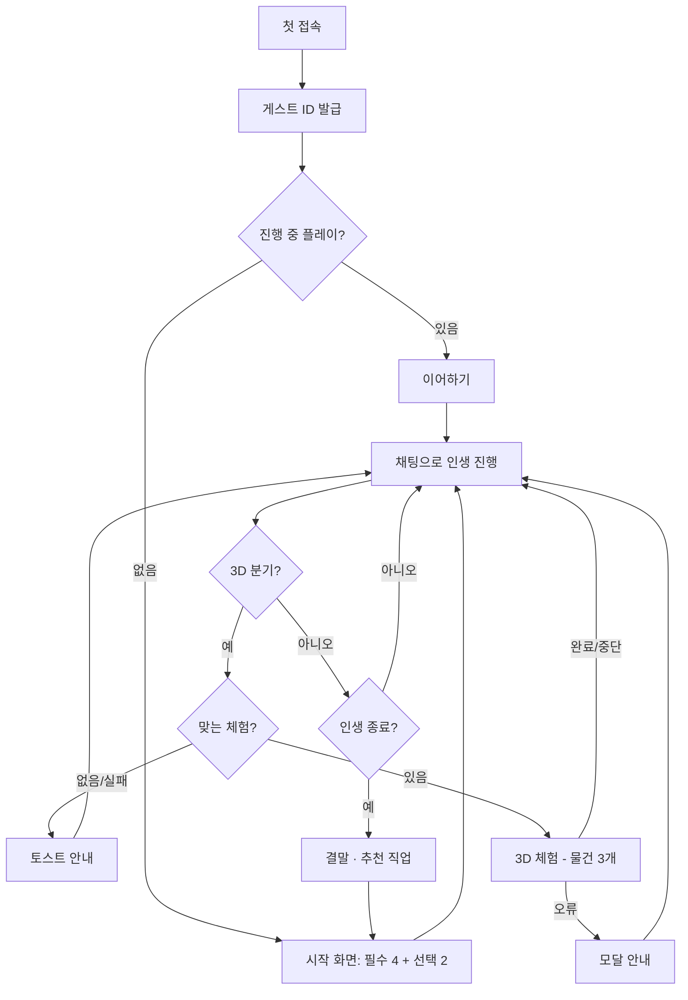

# 01. 사용자 흐름 (서비스 시나리오)

> 사용자가 서비스를 **어떻게 쓰는지**(시작 → 플레이 → 3D 체험 → 결말 → 오류 상황)를 적는다.
> 게임 스토리 · 진행 시나리오(나이별 사건, NPC, 규칙)는 이 문서가 아니라 [../game/](../game/) (시나리오 작가 담당) 에 둔다.
> 기준: [00-idea.md](../00-idea.md) · [features.md](features.md)

## 1. 문제 정의

- "하고 싶은 게 없어"라고 말하는 사람은 다양한 직업과 삶의 방식을 **접해 볼 기회가 부족**하다. 직업 이름을 알아도 실제로 무슨 일을 하고 무엇을 준비해야 하는지 자기 상황에 연결해 이해하기 어렵다
- 진로 정보는 글 · 목록 위주라 재미가 없어 스스로 찾아보지 않는다
- 이 서비스는 **게임으로 여러 인생을 살아 보며** 일상 · 만남 · 직업 체험(3D) 속에서 관심을 발견하고, 경험을 바탕으로 관련 직업과 다음 준비 방향을 추천한다
- 기획 가설이며 실제 수요와 진로 탐색 효과는 검증되지 않았다 ([00-idea.md 2장](../00-idea.md#2-해결하려는-문제))

## 2. 타겟 사용자 (페르소나)

| 사용자 | 특징 | 원하는 것 |
|--------|------|-----------|
| 희망 직업이 없는 학생 | 진로 질문에 "하고 싶은 게 없어"라고 답함. 부모 · 교사의 권유로 시작할 수 있음 | 부담 없이 여러 일을 접해 보고 관심을 발견 |
| 희망 직업이 있는 학생 | 되고 싶은 직업은 있지만 실제 업무 · 준비 과정은 모름 | 그 직업을 향한 경험 · 준비 방향을 알아보기 |
| 진로를 다시 고민하는 성인 | 자신이 무엇을 좋아하는지 모르거나 다른 직업을 알아보고 싶음 | 현재 나이 · 상황에서 출발해 다른 경로를 시험 |

## 3. 핵심 시나리오

### S1. 희망 직업이 없는 학생의 첫 플레이 (정상 흐름)
1. 첫 접속 → 게스트 ID 자동 발급 (FE1 · BE1)
2. 시작 화면에서 이름 · 나이(15) · 상황(중학생) · 희망 직업 없음 입력, 선택 항목 2개 중 관심사만 입력 (FE2 · BE2)
3. 첫 장면이 텍스트로 시작된다. 친구 · 가족 NPC 와 자유롭게 대화한다 (FE3 · BE4 · AI1)
4. 대화 중 NPC 가 비어 있는 선택 항목(예: 잘하는 과목)을 자연스럽게 묻는다 (BE6)
5. 시간이 흐르며 나이 · 자원이 바뀌고 화면에 표시된다 (FE4 · BE5)
6. 중요한 분기에서 3D 체험이 제안된다 → S3
7. 인생이 끝나면 (권장 플레이 시간 약 15분, 강제 제한 아님) 결말과 추천 직업 · 다음 준비 방향을 본다 (FE9 · BE12)
8. "다른 인생 살아 보기"로 새 플레이를 시작한다

### S2. 희망 직업이 있는 학생
1. 시작 화면에서 희망 직업 있음 · "과학자" 입력
2. 게임은 그 직업을 향한 경험(관련 인물 만남 · 활동)을 중심으로 진행한다. **입력만으로 과학자가 되지 않는다**
3. 대화 중 "나 과학자야"라고 말해도 실제 직업은 바뀌지 않고, NPC 는 "과학자가 되고 싶다는 거야?"처럼 반응한다 (BE5 · AI1)
4. 이후는 S1 의 5~8 과 같다

### S3. 3D 직업 체험
1. 채팅 응답에 3D 체험(`experience`)이 오면 체험 화면으로 전환한다 (BE7 · FE5)
2. 사용자가 **시작 버튼**을 누르면 Unity 체험이 시작된다. 소리를 켜려면 게임 화면 안의 효과음 버튼을 누른다
3. 체험에 구성된 오브젝트와 상호작용하는 동안 Unity 이벤트가 실시간으로 백엔드에 저장된다 (FE6 · BE8)
4. 체험을 마치거나 중간에 종료하면 결과가 저장되고 텍스트 모드로 돌아온다 (BE9)
5. 다음 대화에서 NPC 가 체험 결과를 반영해 이야기를 이어 간다

### S4. 3D 체험을 할 수 없을 때 (예외)
| 상황 | 화면 | 이후 |
|------|------|------|
| 맞는 체험이 없음 | 토스트 "지금 상황에 맞는 3D 체험이 없어 텍스트로 이야기를 이어갈게요." | 텍스트 계속 |
| 빌드 로딩 실패 | 토스트 "3D 체험을 불러오지 못했어요. …" | 텍스트 계속 |
| 체험 중 오류 | 모달 + [텍스트로 계속하기] | 텍스트 계속 |
| 탭을 닫아 종료 응답이 없음 | 다음 3D 체험 시작 때 토스트 "종료 응답을 받지 못해 이전 체험을 중단 처리했어요." | 새 체험 진행 (BE10) |

### S5. 이어하기 (예외)
1. 플레이 중 새로고침 · 브라우저 재시작
2. 저장된 게스트 ID 로 진행 중 플레이를 불러와 마지막 대화부터 이어 간다 (FE8 · BE11)
3. 진행 중이던 3D 체험은 재접속만으로 중단 처리하지 않는다

### S6. 허용하지 않는 행동 (예외)
1. 사용자가 게임 안에서 자해 · 범법 행동을 입력
2. AI 는 가이드라인에 따라 그 선택을 진행시키지 않고 흐름을 되돌린다. 위기 표현에는 정해진 대응을 한다 (BE3 · AI1, 기준은 `docs/game/` 가이드라인)
3. 가족과의 의견 충돌 · 정당한 거절은 막지 않는다

### S7. AI 서버 장애 (예외)
1. 채팅 응답이 30초를 넘거나 AI 서버가 실패
2. "잠시 후 다시 시도해 주세요" 안내 (`TIMEOUT` · `AI_UNAVAILABLE`). 입력한 문장은 입력창에 남겨 다시 보낼 수 있게 한다
3. 게임 상태는 바뀌지 않는다

## 4. 유저 플로우

## 5. 시연 순서

> 시연 영상은 2분 이내 ([final-checklist.md](../final-checklist.md)). 3D 체험은 끝까지 확인된 체험으로 고른다 <!-- TODO: 시연에 쓸 체험 확정 -->

| 순서 | 보여 줄 것 | 시간 (안) |
|:---:|------------|:---:|
| 1 | 시작 화면 — "하고 싶은 게 없어요" 상태로 입력 | 15초 |
| 2 | 텍스트 대화 — 자유 입력, NPC 반응, "나 과학자야"에도 상태가 바뀌지 않음 | 30초 |
| 3 | 분기 → 3D 직업 체험 (물건 3개 상호작용) | 40초 |
| 4 | 텍스트 복귀 — 체험 결과가 대화에 반영됨 | 15초 |
| 5 | 결말 · 추천 직업과 다음 준비 방향 | 20초 |

## 상세 기획에 따른 진행 (2026-10-31)

최신 게임 내용은 [인생·직업 상세 기획](../game/06-life-career-design.md)을 따른다. NPC의 기회 제안 → 짧은 직업 소개 → 준비·핵심 업무 체험 → 느낌 확인 → 준비/다른 탐색/유보 선택으로 이어진다. 취업 뒤에는 실제 업무 경험과 관계를 쌓고, 퇴사·이직 때 기존 일을 마무리한다. 직업을 정하지 않아도 생활비와 주변 상황은 진행되며 플레이어에게 대응 기회를 준다. 반복 일상은 경과 요약으로 표현하고 중요한 선택에서 멈춘다. 화면 재개는 마지막 확정 상태에서 시작한다.
