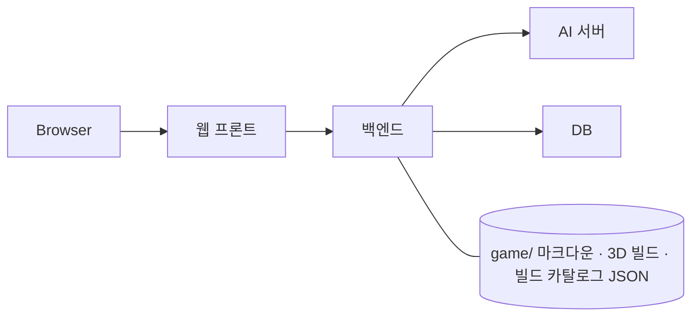

# 02. 시스템 구조 · 내부 절차 · 기술 결정

> 관련 문서: [03-api.md](03-api.md) · [04-database.md](04-database.md) · [features.md](features.md)
> 결정 근거 상세: [12-decisions.md](12-decisions.md) · 미확정: [11-open-issues.md](11-open-issues.md)

## 1. 기술 스택

### 백엔드
> 백엔드 담당 결정. 버전은 프로젝트를 만들 때 고정해 채운다.

| 구분 | 기술 | 버전 | 선택 이유 |
|------|------|------|-----------|
| 언어 | Python | TODO | 기존 시제품 로직 재사용 |
| 프레임워크 | Django + Django REST Framework | TODO | 플레이 세션 생성 · 턴 진행 · 게임 상태 · 대화 조회 API |
| 데이터 검증 | DRF Serializer | TODO | 사용자 입력과 AI 응답 JSON 의 구조 · 값 검증 ([10 3절](10-prompt-assembly.md#3-ai-응답-처리)) |
| AI 서버 통신 | HTTPX | TODO | GPU 서버의 AI API 호출과 타임아웃 처리 |
| DB | PostgreSQL | TODO | 플레이 세션 · 대화 · 턴별 기록 · 게임 상태 · 3D 체험 이벤트 영구 저장 |
| ORM · 마이그레이션 | Django ORM · Django Migrations | TODO | DB 조회 · 저장과 스키마 변경 관리 |
| API 문서 | drf-spectacular | TODO | OpenAPI 명세와 Swagger UI 생성. 기준 계약은 [03-api.md](03-api.md) 이며 생성 문서와 다르면 03 을 고친다 |
| 앱 서버 | Gunicorn (WSGI) | TODO | 배포 환경에서 Django 실행 |
| 프론트 연동 | django-cors-headers | TODO | 프론트가 다른 주소에서 호출하므로 CORS 허용 출처 지정 |
| 직업 데이터 | 기존 JSON 파일 (직업 552개) | — | 직업 정보 로딩 · 조회 |

### AI 서버
| 구분 | 기술 | 버전 | 선택 이유 |
|------|------|------|-----------|
| 실행 환경 | 네이버 클라우드 GPU 서버 | — | 별도 AI 모델 서버 운영 · 추론 |
| | | | |

### 웹 프론트
| 구분 | 기술 | 버전 | 선택 이유 |
|------|------|------|-----------|
| | | | |

### 3D 체험 (Unity WebGL)
| 구분 | 기술 | 버전 | 선택 이유 |
|------|------|------|-----------|
| | | | |

### 외부 서비스
| 서비스 | 용도 | 비고 |
|--------|------|------|
| | | |

## 2. 아키텍처
<!-- 구성 요소와 통신 방향 다이어그램 -->



> 프롬프트 조립과 3D 체험 추천 흐름 상세: [10-prompt-assembly.md](10-prompt-assembly.md)

## 3. 디렉터리 구조
```
<!-- 프로젝트 트리 -->
```

### 컴포넌트 역할
| 파일 / 폴더 | 역할 |
|-------------|------|
| | |

## 4. 핵심 기술 결정: <!-- 예: 인증 방식 JWT vs 세션 -->
### 결론
### 비교
| 기준 | 안 A | 안 B |
|------|------|------|
| | | |
### 이 프로젝트에서 택한 이유
### 약점과 보완

## 5. 내부 처리 절차
<!-- 주요 API 마다 서버 안에서 일어나는 일을 순서대로. 검증 → 처리 → 저장 → 로그 → 응답 -->

### 5-1. <!-- 예: 회원가입 POST /api/auth/signup -->
1. 
2. 

## 6. 외부 연동 메모
<!-- 외부 API 주소, 인증 방식, 타임아웃, 실패 시 처리 -->

## 7. 요청 흐름 요약
