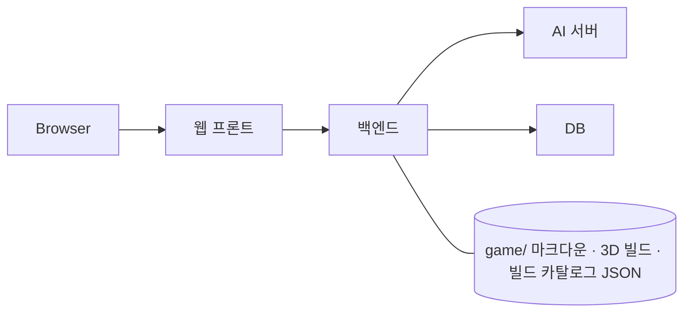

# 02. 시스템 구조 · 내부 절차 · 기술 결정

> 관련 문서: [03-api.md](03-api.md) · [04-database.md](04-database.md) · [features.md](features.md)
> 결정 근거 상세: [12-decisions.md](12-decisions.md) · 미확정: [11-open-issues.md](11-open-issues.md)

## 1. 기술 스택

### 백엔드
> 백엔드 담당 결정. 실제 설치 버전은 `backend/uv.lock`으로 고정한다.

| 구분 | 기술 | 버전 | 선택 이유 |
|------|------|------|-----------|
| 언어 | Python | 3.12.13 | 기존 시제품 로직 재사용 |
| 프레임워크 | Django + Django REST Framework | 5.2.18 (LTS) · 3.16.1 | 플레이 세션 생성 · 턴 진행 · 게임 상태 · 대화 조회 API |
| 데이터 검증 | DRF Serializer | DRF와 동일 | 사용자 입력과 AI 응답 JSON 의 구조 · 값 검증 ([10 3절](10-prompt-assembly.md#3-ai-응답-처리)) |
| AI 서버 통신 | HTTPX | 0.28.1 | GPU 서버의 AI API 호출과 타임아웃 처리 |
| DB | PostgreSQL · Psycopg | 15 계열 · 3.3.6 | 플레이 세션 · 대화 · 턴별 기록 · 게임 상태 · 3D 체험 이벤트 영구 저장 |
| ORM · 마이그레이션 | Django ORM · Django Migrations | Django와 동일 | DB 조회 · 저장과 스키마 변경 관리 |
| API 문서 | drf-spectacular | 0.29.0 | OpenAPI 명세와 Swagger UI 생성. 기준 계약은 [03-api.md](03-api.md) 이며 생성 문서와 다르면 03 을 고친다 |
| 앱 서버 | Gunicorn (WSGI) | 23.0.0 | 배포 환경에서 Django 실행 |
| 컨테이너 | Docker · Docker Compose | Compose v2 | 기존 Python · Django · PostgreSQL 스택을 동일한 이미지와 실행 설정으로 재현 |
| 프론트 연동 | django-cors-headers | 4.9.0 | 프론트가 다른 주소에서 호출하므로 CORS 허용 출처 지정 |
| 직업 데이터 | 기존 JSON 파일 (직업 552개) | — | 백엔드 조회용. AI 의 직업 지식은 AI 서버 RAG 가 담당 |

### AI 서버
| 구분 | 기술 | 버전 | 선택 이유 |
|------|------|------|-----------|
| 실행 환경 | 네이버 클라우드 GPU 서버 | — | 별도 AI 모델 서버 운영 · 추론 |
| 모델 | 오픈소스 Qwen | TODO | 자체 GPU 서버에서 추론 |
| 직업 지식 | RAG (벡터 DB + 임베딩) | TODO | 직업 데이터 552개를 검색해 프롬프트에 붙임 ([10 6절](10-prompt-assembly.md#6-직업-데이터-rag-ai-서버)) |
| | | | |

### 웹 프론트
| 구분 | 기술 | 버전 | 선택 이유 |
|------|------|------|-----------|
| UI | React | TODO | Unity 연결 코드(`Experience.jsx`)가 React 기준 |
| 빌드 | Vite | TODO | Unity 연결 예제 · 환경변수(`VITE_*`)가 Vite 기준 |
| 언어 | TypeScript | TODO | Unity 연결 코드에 타입(`*.d.ts`)이 함께 제공됨 |
| API mock | TODO | — | 백엔드 게임 API 구현 전 개발용 |

### 3D 체험 (Unity WebGL)
| 구분 | 기술 | 버전 | 선택 이유 |
|------|------|------|-----------|
| 엔진 | Unity WebGL | 6000.3.26f1 | Unity 담당 (실서비스 빌드 `career-suite-integration-v005`, 테스트 빌드 `career-suite-test-v009`) |
| 연결 | iframe + postMessage (`docs/unity/frontend/`) | 명세 v003 | Unity 담당 연결 코드 ([docs/unity/USAGE.md](../unity/USAGE.md)) |

### 외부 서비스
| 서비스 | 용도 | 비고 |
|--------|------|------|
| Vercel | 웹 프론트 배포 | SSL 자동 |
| Cloudflare Tunnel (`cloudflared`) | 사설 IP 백엔드 서버를 외부 https 주소로 공개 | 무료 임시 주소, 재실행 때 바뀜 ([06 0절](06-deployment.md#0-배포-환경-한눈에)) |

## 2. 아키텍처
<!-- 구성 요소와 통신 방향 다이어그램 -->



> 프롬프트 조립과 3D 체험 추천 흐름 상세: [10-prompt-assembly.md](10-prompt-assembly.md)

## 3. 디렉터리 구조

> **모노레포:** 프론트 · 백엔드 · 문서를 `base-repo` 하나에 둔다. AI 서버는 별도 저장소 ([12 결정 17](12-decisions.md)).

```
base-repo/
├─ AGENTS.md · CLAUDE.md        ← 저장소 공통 AI 작업 규칙
├─ .github/                     ← 이슈 · PR 템플릿, 워크플로
├─ .dockerignore                ← 백엔드 이미지에서 제외할 파일
├─ docs/                        ← 설계 문서 (docs 브랜치에서 관리)
│  ├─ development/  game/  unity/
├─ frontend/                    ← 웹 프론트 (Vercel Root Directory)
│  ├─ AGENTS.md · CLAUDE.md     ← 프론트 작업 때 꼭 읽을 문서
│  └─ <!-- TODO: 프론트 프로젝트 구조 -->
├─ backend/                     ← Django 백엔드 (서버에서 실행, 아래 상세)
│  ├─ AGENTS.md · CLAUDE.md     ← 백엔드 작업 때 꼭 읽을 문서
└─ scripts/                     ← 저장소 관리 스크립트 (라벨 생성 등)

(별도 저장소) ai-server/        ← Qwen + RAG
```

### 컴포넌트 역할
| 파일 / 폴더 | 역할 | 라벨 · scope |
|-------------|------|:---:|
| `frontend/` | 화면 · Unity 체험 연결 · 백엔드 API 호출 | `fe` |
| `backend/` | API · DB · 프롬프트 조립 · 3D 이벤트 저장 · 빌드 제공 | `be` |
| AI 서버 저장소 | 대화 생성 · 3D 추천 · 직업 RAG | `be` |
| `docs/` | 설계 문서 · Unity 전달물 · 게임 콘텐츠 | (생략, `docs:`) |
| `docs/unity/frontend/` | Unity 연결 코드 원본 — **참고만 하고** `frontend/` 로 복사하지 않는다 | — |
| `docs/game/` | 시나리오 · 가이드라인 — 백엔드가 읽어 매 AI 요청에 넣는다 (배포 때 서버에 함께 있어야 함) | — |

#### `backend/` 상세 (백엔드 담당)

```text
backend/
├─ manage.py
├─ pyproject.toml / uv.lock / .python-version
├─ .env.example                # 변수 이름만 공유, 실제 .env는 Git 제외
├─ Dockerfile                  # uv.lock 기반 런타임 이미지, 일반 사용자 실행
├─ compose.yaml                # Gunicorn WSGI + PostgreSQL
├─ compose.dev.yaml            # 개발용 자동 새로고침 · 소스 연결 · DB 호스트 포트
├─ gunicorn.conf.py            # WSGI 실행 설정
├─ config/
│  ├─ settings.py              # 환경변수 · DB · DRF · CORS
│  ├─ urls.py                  # 전체 URL · OpenAPI · Swagger
│  └─ wsgi.py
├─ apps/
│  └─ core/                   # 상태 확인 API · 기반 테스트
└─ scripts/
   ├─ init_local_env.py        # 비밀값을 생성해 로컬 .env에만 저장
   └─ start_container.sh       # migration · 정적 파일 수집 후 서버 실행
docs/
├─ development/                # 설계 · API 계약 · 실행 안내
└─ game/                       # 시나리오 작가 담당 마크다운
```

#### 백엔드 컴포넌트 (백엔드 담당)
| 파일 / 폴더 | 역할 |
|-------------|------|
| `backend/config/` | 환경과 진입점. 설정은 `.env` 또는 서버 환경변수로 주입하며 서버 환경변수가 우선한다 |
| `backend/apps/core/` | `GET /api/health`: DB `SELECT 1` 성공 시 200, 연결 실패 시 503. 인증 없이 호출하며 접속 정보는 노출하지 않는다 |
| `backend/scripts/` | 로컬 설정 준비. 기존 `.env`가 있으면 덮어쓰지 않는다 |
| `backend/Dockerfile` · 루트 `.dockerignore` | Python 3.12.13과 기존 uv.lock으로 이미지를 빌드. `.env` · 로컬 DB · 가상환경 · Unity 빌드는 제외하고 `docs/game/`은 포함 |
| `backend/compose.yaml` | Gunicorn WSGI와 PostgreSQL. DB 준비 후 migration · 정적 파일 수집, API healthcheck. DB와 정적 파일은 named volume에 보관 |
| `backend/compose.dev.yaml` | Django 개발 서버로 변경하고 소스를 연결. migration 생성용 `apps/`는 쓰기를 허용하고 설정 · 스크립트 · 게임 문서는 읽기 전용. DB 호스트 접속은 기본 5433 |
| `backend/apps/` | 후속 작업에서 플레이 · AI 연동 앱을 추가. 현재는 게임 모델 · 인증 · AI 요청을 구현하지 않는다 |

Swagger는 `/api/docs/`, OpenAPI는 `/api/schema/`에서 제공한다. 현재 실행 가능한 API는 상태 확인뿐이며, [03-api.md 1부](03-api.md#1부-프론트--백엔드)의 게임 API는 후속 구현 대상이다. 게스트 방식이므로 이번 세팅에서는 Django 사용자 · 세션 · 관리자 앱과 사용자 테이블을 만들지 않는다.

## 4. 핵심 기술 결정: <!-- 예: 인증 방식 JWT vs 세션 -->
### 결론
### 비교
| 기준 | 안 A | 안 B |
|------|------|------|
| | | |
### 이 프로젝트에서 택한 이유
### 약점과 보완

## 5. 내부 처리 절차
<!-- 주요 API 마다 서버 안에서 일어나는 일을 순서대로. 검증 → 처리 → 저장 → 로그 → 응답 -->

### 5-1. <!-- 예: 회원가입 POST /api/auth/signup -->
1. 
2. 

## 6. 외부 연동 메모
<!-- 외부 API 주소, 인증 방식, 타임아웃, 실패 시 처리 -->

## 7. 요청 흐름 요약
