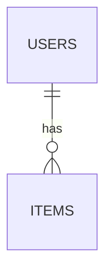

# 04. DB 구조

> 관련 문서: [03-api.md](03-api.md) · [02-architecture.md](02-architecture.md)

## ERD


## 테이블 상세

### <!-- 테이블 이름 -->
| 컬럼 | 타입 | 제약 | 설명 |
|------|------|------|------|
| id | | PK | |

> <!-- 이 테이블에 대한 주의 사항 (외부에 노출하지 않을 컬럼, 인덱스 이유 등) -->

## 주요 쿼리
<!-- API 마다 실제로 쓰는 조회 SQL -->
```sql
```

## 설계 기준 DDL
```sql
```

## 데이터 접근 계층
<!-- 리포지토리/CRUD 계층을 어떻게 나눴는지 -->

## DB 확인 방법
<!-- 저장이 잘 됐는지 직접 확인하는 명령 -->

## 운영 주의
<!-- 백업, 영구 저장소, 마이그레이션 방식 -->
