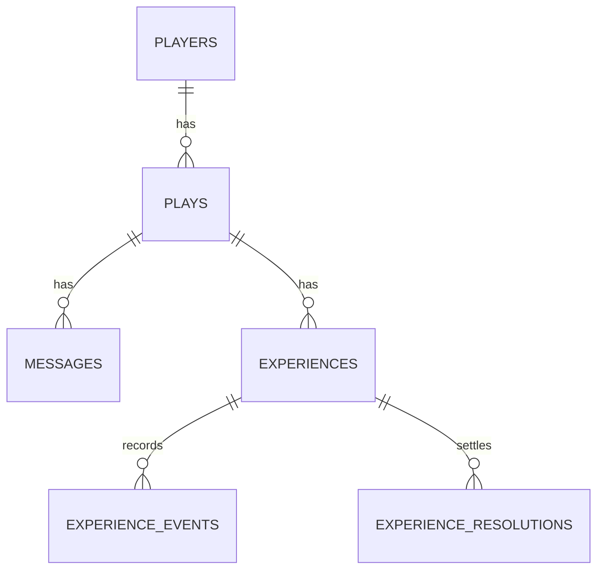

# 04. DB 구조

> 관련 문서: [03-api.md](03-api.md) · [02-architecture.md](02-architecture.md) · [10-prompt-assembly.md 5절](10-prompt-assembly.md#5-플레이어-기록-항목)
> DB: **PostgreSQL** · Django ORM · Django Migrations. JSON 컬럼은 `jsonb`.
> 1차 설계안이다. 백엔드 담당이 모델을 만들며 바꾸면 이 문서도 같은 PR 에서 고친다.

## ERD


## 테이블 상세

### players
| 컬럼 | 타입 | 제약 | 설명 |
|------|------|------|------|
| id | uuid | PK | `playerId` (게스트) |
| created_at | timestamptz | NOT NULL | |

### plays
| 컬럼 | 타입 | 제약 | 설명 |
|------|------|------|------|
| id | uuid | PK | `playId` |
| player_id | uuid | FK players, NOT NULL | 소유자 (모든 API 에서 `X-Player-Id` 와 대조) |
| session_id | varchar | UNIQUE, NOT NULL | Unity `sessionId`. 플레이 동안 유지 |
| profile | jsonb | NOT NULL | 기본 정보: 필수 4개 + 채워진 선택 항목 ([10 5절](10-prompt-assembly.md#5-플레이어-기록-항목)) |
| state | jsonb | NOT NULL | 나이·원화 자금·빚·건강·에너지·스트레스 및 상황별 상태. 아래 인생 진행 저장 범위 참조 |
| experience_results | jsonb | NOT NULL, 기본 `[]` | 끝난 3D 체험 요약 (프롬프트에 넣는 용도) |
| ended | boolean | NOT NULL | 인생 종료 여부 |
| ending | jsonb | NULL | 결말 · 추천 직업 (BE12) |
| started_at · updated_at | timestamptz | NOT NULL | |

> 실제 사용자의 건강·질병 정보를 질문하거나 게임 프로필·기억으로 구조화해 저장하지 않는다. 가상 캐릭터의 건강 수치와 게임 속 합병증 사건은 구분해 저장한다. 원문 대화에 실제 민감정보가 섞인 경우 공통 가이드라인에 따라 저장 전 제외한다.

### messages
| 컬럼 | 타입 | 제약 | 설명 |
|------|------|------|------|
| id | bigint | PK | |
| play_id | uuid | FK plays, NOT NULL | |
| turn | int | NOT NULL | 턴 번호. (play_id, turn) 인덱스 |
| role | varchar | NOT NULL | `user` · `npc` · `narrator` |
| speaker | varchar | NULL | NPC 이름 |
| text | text | NOT NULL | |
| state_changes | jsonb | NULL | 이 턴에 실제 반영한 변경 |
| created_at | timestamptz | NOT NULL | |

### experiences
| 컬럼 | 타입 | 제약 | 설명 |
|------|------|------|------|
| experience_id | varchar | PK | Unity `experienceId` (프론트가 생성) |
| play_id | uuid | FK plays, NOT NULL | |
| session_id | varchar | NOT NULL | |
| build_id · room_id · scenario_id · scenario_version | varchar | NOT NULL | 추천 · 허용 목록과 일치해야 함 |
| lifecycle_status | varchar | NOT NULL | `recommended` · `started` · `ended` · `pending_reconciliation` · `deferred_active` · `interrupted` · `not_started` |
| lease_expires_at | timestamptz | NULL | 마지막 생존 신호 + 120초 |
| ended_event_id | varchar | NULL | 받은 `experience.ended` 의 eventId |
| result_summary | jsonb | NULL | outcome · 평가 코드 · 해석 (플레이어 기록 반영용) |
| created_at · updated_at | timestamptz | NOT NULL | |

### experience_events
| 컬럼 | 타입 | 제약 | 설명 |
|------|------|------|------|
| id | bigint | PK | |
| session_id | varchar | NOT NULL | UNIQUE (session_id, event_id) |
| event_id | varchar | NOT NULL | |
| experience_id | varchar | FK experiences, NULL | 제어 오류 등 eventId 없는 응답은 저장하지 않음 |
| sequence | int | NOT NULL | 순서 복원 · 최신 스냅샷 판단 |
| type | varchar | NOT NULL | |
| scope_key | varchar | NOT NULL | scenarioRunId · scope · stepId · objectId · workItemId 묶음 (최신 상태 판단 범위) |
| payload | jsonb | NOT NULL | Unity 원본 그대로 |
| payload_hash | char(64) | NOT NULL | 같은 ID 다른 내용(충돌) 판단 |
| conflict | boolean | NOT NULL | 충돌로 격리된 원본이면 true |
| received_at | timestamptz | NOT NULL | |

> 원본은 지우지 않는다. 늦게 온 이벤트도 저장하되 최신 상태는 범위별 가장 큰 sequence 로 판단한다.

### experience_resolutions
| 컬럼 | 타입 | 제약 | 설명 |
|------|------|------|------|
| id | bigint | PK | |
| resolution_id | varchar | NOT NULL | UNIQUE (resolution_id, revision) |
| revision | int | NOT NULL | 늦은 실제 종료로 정정하면 +1 |
| reconcile_request_id | varchar | NOT NULL | 같은 요청 · 같은 내용이면 같은 응답 |
| experience_id | varchar | FK experiences, NOT NULL | 정산 대상 (이전 체험) |
| lifecycle_status | varchar | NOT NULL | |
| payload | jsonb | NOT NULL | `experience.reconciled` 응답 원본 |
| resolved_at | timestamptz | NOT NULL | |

## 주요 쿼리
```sql
-- 프롬프트용 최근 20턴
SELECT role, speaker, text FROM messages WHERE play_id = :play ORDER BY turn DESC, id DESC LIMIT 40;

-- 이벤트 중복 · 충돌 판단
SELECT payload_hash FROM experience_events WHERE session_id = :session AND event_id = :event;

-- 범위별 최신 상태
SELECT DISTINCT ON (scope_key) scope_key, payload FROM experience_events
WHERE experience_id = :exp AND NOT conflict ORDER BY scope_key, sequence DESC;

-- 정산 대상: 종료 응답 없이 lease 가 끝난 이전 체험
SELECT * FROM experiences WHERE play_id = :play AND ended_event_id IS NULL
AND lifecycle_status IN ('started','pending_reconciliation') AND lease_expires_at < now() FOR UPDATE;
```

## 설계 기준 DDL
<!-- TODO: Django 모델 작성 후 `python manage.py sqlmigrate` 결과로 채운다 -->

## 데이터 접근 계층
- Django ORM 모델 = 위 테이블. 이벤트 저장과 정산은 **트랜잭션 + 행 잠금(`select_for_update`)** 으로 처리한다 (같은 체험의 동시 정산 · 늦은 종료 경합 방지, Unity 명세 v003 의 "원자적 fence")

## DB 확인 방법
```bash
python manage.py dbshell
# \dt  ·  SELECT count(*) FROM experience_events WHERE session_id = '…';
```

## 운영 주의
- PostgreSQL 은 백엔드 서버에 함께 둔다 <!-- TODO: 같은 서버 설치 여부 · 백업 방법 (백엔드 담당) -->
- 스키마 변경은 Django Migrations 로만 한다
- `experience_events` 는 계속 늘어난다. 시연 기간에는 지우지 않는다

## 인생 진행 저장 범위 (2026-10-31)

기획 기준: [인생·직업 게임 상세 기획](../game/06-life-career-design.md). 다음은 기존 `plays`와 관련 기록을 확장하는 설계이며 마이그레이션 적용 상태가 아니다.

| 저장 단위 | 내용 |
|---|---|
| 현재 상태 | 원화 잔액·총부채, 건강·에너지·스트레스, 주거·생활비, 현재 직업/준비 상황, 성적 또는 자기계발 |
| 부채·미납 내역 | 채권자(기관/지인), 잔액, 발생·상환·연체 사건. 총부채와 일치하도록 갱신 |
| 기간 처리 근거 | 마지막 정산 게임 날짜, 이미 처리한 월, 건강 0·고스트레스·과로 및 회복 지속 기간. 같은 달 중복 적용 금지 |
| 턴 요청 | 플레이별 `requestId`, 입력 내용 비교값, 생성에 사용한 상태 버전, 처리 상태, 저장된 응답. 동일 요청의 중복 실행 방지 |
| 사건 | 사건 ID·게임 날짜·관련 인물·확정 사실·원인 행동/체험 ID. 전체 대본과 구분한 요약 |
| NPC별 기억 | NPC 식별자, 참조 사건, 직접 경험/청취/전달 구분, 사실, 감정·해석. 감정과 해석을 플레이어의 확정 상태와 분리 |
| 정보 전달 | 전달자·수신자·대상 사건/사실·전달 계기·게임 날짜. 실제 전달 근거가 있을 때만 수신자 기억에 추가 |
| 재개 | 마지막 확정 턴·장면·선택 대기 상황, 일시정지 상태, 실제 활성 플레이 시간과 게임 날짜의 구분 |

논리 저장 항목은 우선 기존 JSONB와 관련 사건 기록으로 수용할 수 있다. 물리 테이블·인덱스는 백엔드 모델 구현에서 확정하되, 플레이·요청 ID의 고유성 및 NPC별 접근 범위는 유지한다. BGE-M3로 기억 후보를 찾기 전에 `playId`와 NPC 공개 범위를 제한하며, 검색 후 프롬프트에 넣을 때도 범위를 재확인한다. 다른 플레이나 다른 NPC의 비공개 기억은 유사도가 높아도 반환하지 않는다.

상태 버전을 대조하고 턴 대화·사건·재정·상태를 같은 트랜잭션으로 확정한다. 초기 보증금과 같은 이미 지급한 금액, 월급·지출, 과로 사건과 3D 결과는 원인 기록을 이용해 중복 반영하지 않는다.


2026-11-01 구현: `plays`에 `state_version`, `paused`, `active_seconds`, `turn_started_at`, 비공개 `progress` JSONB를 추가한다. `progress`는 월별 원장·지속 기간·선택 대기·장면을 보관한다. 이전 추상 수치는 새 원화/흥미 값으로 오인하지 않고 `progress.legacyState`에 보존하며 다음 유효 턴에서 새 상태 형식으로 전환한다.

`game_turnrequest`는 플레이·request_id 고유 제약과 입력·생성 버전·pending/failed/completed·응답을 저장한다. `game_gameevent`는 플레이·key 고유 사건과 참여자·사실·게임 날짜·원인 행동을 저장한다. `game_npc`는 플레이·key 고유 인물, `game_npcmemory`는 인물·사건 고유 기억(획득 경로·감정·해석), `game_informationtransfer`는 전달자·수신자·사건 고유 전달 근거를 저장한다. 모든 공개·기억 조회는 현재 플레이 범위로 제한한다. `Turn.context`에 입력/응답의 NPC 공개 범위를 분리해 보관한다. 관련 migration은 0018~0021이다.
